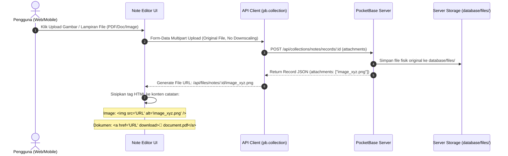
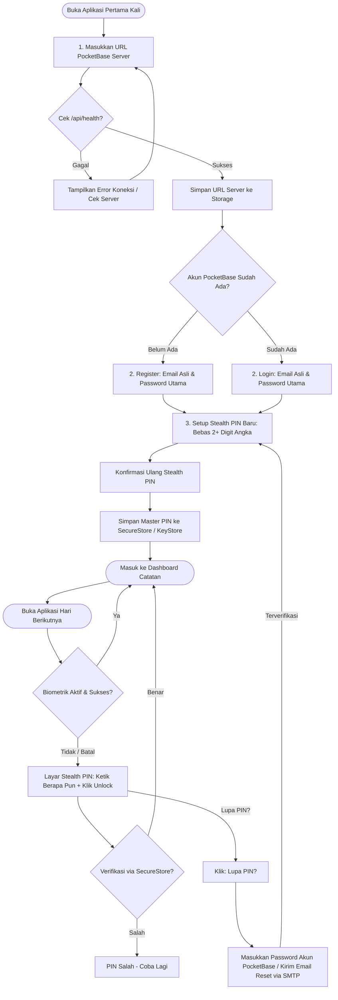
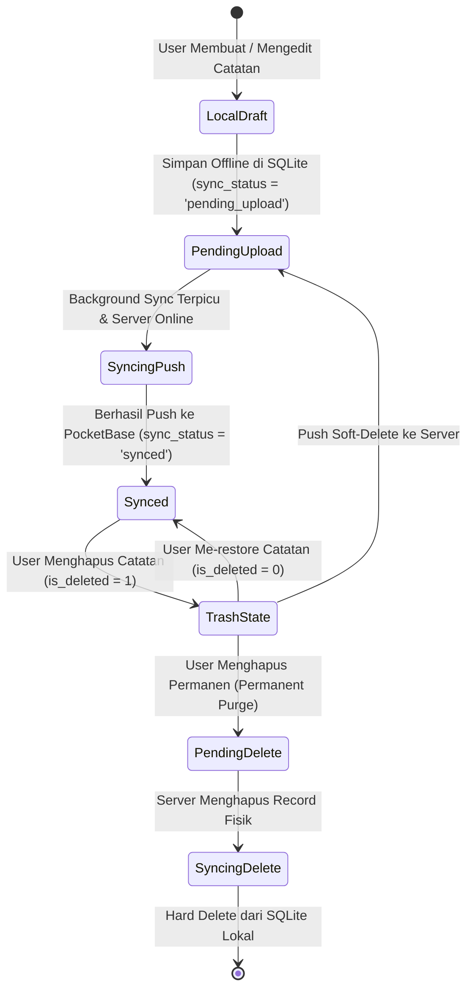

# CloudNotes — Master Architectural Blueprint & Implementation Specification

> **Project Name:** `CloudNotes`  
> **System Classification:** Multiplatform Offline-First Note-Taking System with Stealth Variable-Length PIN, Native Server Media Storage & End-to-End Cryptography  
> **Target Deployment:** 100% Public Open-Source Monorepo (Web, Mobile, Backend, Deployment Containers)

---

## 1. Executive Summary & Core Philosophy

**CloudNotes** adalah sistem aplikasi catatan pribadi lintas platform (*Web SPA* & *Expo Mobile App*) yang mandiri (*self-hosted*), mengutamakan kedaulatan data (*privacy-first*), bekerja tanpa ketergantungan koneksi (*offline-first*), serta memiliki proteksi keamanan brankas pribadi (*personal vault*) berstandar industri.

### Empat Pilar Arsitektur Baru:
1. **Variable-Length Stealth PIN & Recovery Model:**
   - Panjang PIN tidak lagi dibatasi atau di-hardcode 4 digit (bebas: 2 digit, 6 digit, 9 digit, dsb.).
   - UI input login **tidak membocorkan panjang PIN** (tidak ada 4 bulatan/dot kosong statis yang membatasi input). Pengguna dapat mengetik angka sebanyak apa pun lalu menekan tombol konfirmasi/submit (*stealth defense against shoulder surfing & brute-force*).
   - Autentikasi akun induk PocketBase didasarkan pada Email asli pengguna dengan dukungan pemulihan kata sandi (*Password Reset via SMTP Email*) bawaan PocketBase untuk mencegah pengguna terkunci permanen.
2. **True End-to-End Client-Side Cryptography (AES-GCM 256-bit):**
   - Catatan yang dikunci (`is_locked: true`) dienkripsi di sisi client sebelum disimpan ke SQLite lokal maupun sebelum dikirim ke PocketBase.
   - Kunci enkripsi diturunkan menggunakan PBKDF2 (SHA-256, minimal 100.000 iterasi) dengan salt kriptografis acak 16-byte.
3. **Native Server-Side Media & File Storage (`database/files`):**
   - Mendukung unggahan gambar resolusi penuh (tanpa *downscaling* paksa / *lossless quality*) dan file lampiran dokumen (PDF, audio, arsip) langsung di dalam editor catatan.
   - Semua file fisik disimpan di server PocketBase masing-masing pengguna di dalam folder `database/files/` (atau volume container terdedikasi), sedangkan editor hanya menyimpan URL referensi media.
4. **Trash Bento Card & Safe Soft-Delete:**
   - Catatan yang dihapus tidak langsung dimusnahkan, melainkan masuk ke status Trash (*soft-delete*).
   - Terdapat **Trash Bento Card** khusus yang selalu berada di posisi kartu paling terakhir di grid dashboard utama (atau menjadi kartu pertama jika tidak ada catatan aktif sama sekali).
   - Mengklik Trash Card membuka tampilan galeri bento khusus tempat pengguna dapat me-*restore* catatan atau menghapusnya secara permanen.

---

## 2. Strict Open-Source Compliance & Zero Personal Secrets Policy

> [!CAUTION]
> **PERATURAN MUTLAK REPOSITORI OPEN SOURCE**  
> Proyek `CloudNotes` dirancang sejak hari pertama untuk dipublikasikan secara terbuka di GitHub. Dilarang keras menaruh, meng-hardcode, atau meng-commit informasi pribadi atau kredensial rahasia apa pun ke dalam repositori.

### Standar Sanitasi Wajib:
1. **Zero Personal Credentials:**
   - Dilarang mencantumkan email asli developer, password, API key AI pribadi (Gemini/OpenAI/Groq/DeepSeek), atau Cloudflare Tunnel Token rahasia (`eyJh...`).
   - Gunakan format template di `.env.example` dan docker configuration.
2. **Standard RFC 2606 Dummy Domains:**
   - Semua contoh URL di dokumentasi, kode, dan placeholder wajib menggunakan:
     - `https://notes.example.com`
     - `http://127.0.0.1:8090` atau `http://localhost:8090`
     - `user@example.com`
   - Dilarang menggunakan domain pribadi, subdomain pribadi, atau IP VPS server pribadi.
3. **Karantina File & Git Hygiene (`.gitignore`):**
   - File biner (`*.exe`, `*.dll`, `*.so`), database fisik (`pb_data/`), folder file server (`database/files/`, `pb_files/`), dan file environment lokal (`.env`, `.env.local`) wajib masuk `.gitignore` sebelum commit pertama dilakukan.

---

## 3. Technology Stack & Tooling Matrix

| Layer / Area | Teknologi / Library | Alasan Pemilihan & Kegunaan |
| :--- | :--- | :--- |
| **Monorepo Engine** | **npm Workspaces** | Native, tanpa overhead tool pihak ketiga, isolasi dependency bersih antar-package. |
| **Backend & Database** | **PocketBase (v0.22+)** | Single executable Go + SQLite, built-in REST & Realtime SSE, native Auth, Mail SMTP client, dan file storage statis. |
| **Web Frontend** | **React 18/19 + Vite 5** | Performa rendering cepat, arsitektur komponen modular, build output statis langsung disajikan oleh PocketBase. |
| **Web Styling** | **Tailwind CSS + Lucide Icons** | Design token konsisten, responsive utility layout, dark/light theme native. |
| **Mobile Runtime** | **React Native (v0.74+) + Expo (SDK 51/52)** | Multiplatform iOS & Android dengan dukungan Hermes engine berkecepatan tinggi. |
| **Mobile Navigation** | **Expo Router (File-based routing)** | Navigasi deklaratif berbasis struktur folder, deep-linking native, transisi native stack. |
| **Mobile Storage** | **expo-sqlite** | Database SQLite lokal terisolasi di penyimpanan perangkat untuk operasional full offline. |
| **Hardware Secrets** | **expo-secure-store** | Menyimpan master PIN dan auth tokens di hardware Keystore (Android) / Keychain (iOS). |
| **Mobile Biometrics** | **expo-local-authentication** | Otentikasi instan sidik jari (Fingerprint) atau pengenalan wajah (Face ID). |
| **Canvas & Drawing** | **HTML5 Canvas (Web) + Svg/PanResponder (Mobile)** | Freehand note doodling, sketsa, dan highlight tulisan tangan yang diserialisasi menyatu dengan konten teks. |
| **Kriptografi** | **WebCrypto API (`crypto.subtle`)** | Standar native modern tanpa dependensi eksternal untuk AES-GCM 256-bit dan PBKDF2. |
| **AI Note Assistant** | **Multi-Provider BYOK (Gemini, OpenAI, Groq, DeepSeek)** | Interaksi AI cerdas berbasis konteks catatan lokal dengan perlindungan kunci API terisolasi. |
| **Deployment / CI** | **Docker Compose + Cloudflare Tunnel** | Container orchestration self-hosted bebas port-forwarding dengan sertifikat SSL otomatis. |
| **Test Suite** | **Vitest** | Runner unit test kilat berbasis ESM untuk menguji entitas, mapper, kriptografi, dan utilitas murni. |

---

## 4. Monorepo Directory Architecture

```
cloudnotes/
├── apps/
│   ├── web/                           # Web SPA Client
│   │   ├── public/                    # Favicon, static manifest, web icons
│   │   ├── src/
│   │   │   ├── components/            # UI components (Editor, Modals, Cards, Nav, TrashGallery)
│   │   │   ├── hooks/                 # Custom React hooks (useNotes, useAuth, useTheme, useUploader)
│   │   │   ├── lib/                   # PocketBase client instance, session, crypto helpers
│   │   │   ├── App.tsx                # Main entry application view router
│   │   │   └── main.tsx               # DOM mount point
│   │   ├── index.html
│   │   ├── package.json
│   │   ├── tsconfig.json
│   │   └── vite.config.ts             # Configured build target: ../../database/pb_public
│   │
│   └── mobile/                        # Expo React Native Client
│       ├── assets/                    # Icon, splash, adaptive icons (PNG format only)
│       ├── src/
│       │   ├── app/                   # Expo Router routes
│       │   │   ├── (auth)/            # Server connect, login, PIN setup, reset
│       │   │   ├── (main)/            # Dashboard, [id] note editor, trash gallery, settings, AI
│       │   │   └── _layout.tsx        # Root navigation stack & auth gate provider
│       │   ├── components/            # Mobile UI atoms, sync badges, drawing layers, trash cards
│       │   ├── context/               # AuthContext, ThemeContext
│       │   ├── db/                    # SQLite client, schema migration, local queries
│       │   ├── services/              # Sync engine, security biometrics, pin service, file uploader
│       │   └── widgets/               # Android Homescreen Widgets (2x2, 4x2 launcher)
│       ├── app.json                   # Expo application metadata & permissions
│       ├── package.json
│       └── tsconfig.json
│
├── packages/
│   ├── shared-types/                  # Shared domain contracts & pure logic
│   │   ├── src/
│   │   │   ├── note.ts                # Note entity, Stroke, LocalNote interfaces & mappers
│   │   │   ├── crypto.ts              # AES-GCM & PBKDF2 WebCrypto encrypt/decrypt logic
│   │   │   ├── crypto.test.ts         # Unit tests for cryptographic module
│   │   │   ├── vault.ts               # Variable-length PIN rules & vault password derivation
│   │   │   ├── vault.test.ts          # Unit tests for vault functions
│   │   │   ├── ai.ts                  # AI provider types, prompt builders, executor
│   │   │   └── index.ts               # Central barrel exports
│   │   ├── package.json
│   │   └── tsconfig.json
│   │
│   └── design-system/                 # Universal UI tokens & palettes
│       ├── src/
│       │   ├── colors.ts              # Note cover palettes (Amber, Emerald, Obsidian, etc.)
│       │   ├── tokens.ts              # Radii, elevation, spacing constants
│       │   └── index.ts
│       ├── package.json
│       └── tsconfig.json
│
├── database/
│   ├── pb_migrations/                 # Declarative JavaScript migrations for PocketBase
│   ├── pb_data/                       # SQLite storage directory for PocketBase (git-ignored)
│   ├── pb_public/                     # Auto-built static web assets served by PocketBase
│   └── files/                         # Uploaded original media & attachment files (git-ignored)
│
├── deploy/
│   ├── docker-compose.yml             # PocketBase service + Cloudflare Tunnel container stack
│   └── cloudflared/                   # Cloudflare Tunnel ingress configuration template
│
├── .env.example                       # Reference environment variables with dummy values
├── .gitignore                         # Excludes node_modules, .exe, dist, pb_data, database/files
├── package.json                       # Root workspaces configuration & master scripts
├── tsconfig.base.json                 # Shared root TypeScript compiler options
└── README.md                          # Comprehensive documentation
```

---

## 5. Database Schema & Data Models

### 5.1 PocketBase Collection: `users` (System Auth)
Collection bawaan PocketBase untuk manajemen identitas pengguna.

| Field | Type | Rules & Constraints | Keterangan |
| :--- | :--- | :--- | :--- |
| `id` | `TEXT (15)` | Primary Key | ID unik akun pengguna. |
| `email` | `EMAIL` | Required, Unique | Alamat email asli user untuk recovery. |
| `password` | `PASSWORD` | Min 8 chars, Required | Password akun utama PocketBase. |
| `name` | `TEXT` | Optional | Display name pengguna. |
| `avatar` | `FILE` | Optional | Gambar profil. |

---

### 5.2 PocketBase Collection: `notes`

| Field | Type | Constraints | Deskripsi |
| :--- | :--- | :--- | :--- |
| `id` | `TEXT (15)` | Primary Key | ID catatan unik 15 karakter. |
| `user_id` | `RELATION` | Required, Cascade Delete | Relasi ke collection `users.id`. |
| `title` | `TEXT` | Default: `'Untitled Note'` | Judul catatan. |
| `cover_color`| `TEXT` | Default: `'#F59E0B'` | Hex warna aksen kartu catatan. |
| `cover_icon` | `TEXT` | Default: `'file-text'` | Nama ikon Lucide / icon pack. |
| `content` | `TEXT` | Optional, Unlimited | Isi teks HTML catatan + serialisasi layer sketsa + tag `` referensi server. |
| `excerpt` | `TEXT` | Max 200 chars | Cuplikan teks untuk kartu list. Jika terkunci, berisi placeholder aman. |
| `attachments`| `FILE[]`| Optional, Max 100MB/file | Array file fisik / gambar original yang tersimpan di server (`database/files`). |
| `is_locked` | `BOOL` | Default: `false` | Menandai catatan terenkripsi dengan PIN. |
| `is_archived`| `BOOL` | Default: `false` | Menandai catatan masuk tab arsip. |
| `is_deleted` | `BOOL` | Default: `false` | Menandai catatan masuk ke Trash (*soft-delete*). |
| `deleted_at` | `DATETIME` | Optional | Timestamp saat catatan dimasukkan ke Trash. |
| `version` | `NUMBER` | Default: `1` | Nomor revisi untuk resolusi konflik sinkronisasi. |
| `client_updated_at` | `DATETIME` | Required | Timestamp update dari jam lokal perangkat saat edit. |
| `updated` | `DATETIME` | System Generated | Timestamp perubahan terakhir di server. |
| `created` | `DATETIME` | System Generated | Timestamp pembuatan pertama kali. |

---

### 5.3 SQLite Mobile Local Table: `local_notes`

```sql
CREATE TABLE IF NOT EXISTS local_notes (
    id TEXT PRIMARY KEY NOT NULL,
    title TEXT NOT NULL,
    cover_color TEXT NOT NULL,
    cover_icon TEXT NOT NULL DEFAULT 'file-text',
    content TEXT NOT NULL,
    excerpt TEXT NOT NULL,
    is_locked INTEGER NOT NULL DEFAULT 0,
    is_archived INTEGER NOT NULL DEFAULT 0,
    is_deleted INTEGER NOT NULL DEFAULT 0,
    deleted_at TEXT,
    sync_status TEXT NOT NULL DEFAULT 'synced', -- 'synced' | 'pending_upload' | 'pending_delete'
    version INTEGER NOT NULL DEFAULT 1,
    updated_at TEXT NOT NULL,
    client_updated_at TEXT NOT NULL
);

CREATE INDEX IF NOT EXISTS idx_local_notes_sync ON local_notes(sync_status);
CREATE INDEX IF NOT EXISTS idx_local_notes_deleted ON local_notes(is_deleted);
CREATE INDEX IF NOT EXISTS idx_local_notes_updated ON local_notes(client_updated_at DESC);
```

---

## 6. Trash Bento Card System & Lifecycle

Berdasarkan revisi:
> *"Kalo data udah dihapus masukin ke card trash. Taruh di card paling terakhir. Jadi kalo gada notes sama sekali ya dia ada di paling pertama card. Pas klik trash nanti UI-nya persis seperti halaman utama bento card."*

### 6.1 Posisi & Logika Render Trash Card di Dashboard
Pada grid Bento Notes di dashboard utama (Web & Mobile):
1. **Daftar Catatan Aktif:** Mengambil catatan dengan filter `is_deleted = 0` (dan `is_archived = 0` pada tab All).
2. **Kalkulasi Posisi Trash Card:**
   - **Kondisi Ada Catatan ($N > 0$):** Trash Card di-render tepat di **urutan ke-$(N+1)$** (kartu penutup paling akhir di grid).
   - **Kondisi Kosong ($N = 0$):** Trash Card otomatis tampil sebagai **kartu pertama dan utama** di grid!
3. **Visual Trash Bento Card:**
   - Didesain menyatu dengan estetika bento: border halus, aksen warna netral/rose muda, icon `Trash2`, judul *"Trash Bin"*, dan badge jumlah catatan terbuang (*contoh: "3 items"*).
   - Jika trash kosong: menampilkan *"Trash is empty"*.

```tsx
// Logika Penataan Bento Grid di Web/Mobile
const activeNotes = notes.filter(n => !n.is_deleted && !n.is_archived);
const deletedNotes = notes.filter(n => n.is_deleted);

return (
  <div className="grid grid-cols-1 sm:grid-cols-2 lg:grid-cols-3 gap-4">
    {activeNotes.map(note => (
      <NoteCard key={note.id} note={note} onClick={() => openNote(note.id)} />
    ))}
    
    {/* Trash Bento Card: Selalu di posisi terakhir, atau pertama jika notes kosong */}
    <TrashBentoCard 
      count={deletedNotes.length} 
      onClick={() => setView('trash_gallery')} 
    />
  </div>
);
```

### 6.2 Halaman / Tampilan Trash Gallery
Ketika Trash Bento Card diklik, aplikasi membuka tampilan galeri dengan format Bento Grid yang identik dengan halaman utama:
- **Aksi pada Tiap Catatan di Trash:**
  1. **Restore Note:** Memulihkan catatan kembali ke grid aktif (`is_deleted = 0`, `deleted_at = null`, `sync_status = 'pending_upload'`).
  2. **Delete Permanently:** Menghapus catatan permanen dari SQLite lokal dan PocketBase server (`sync_status = 'pending_delete'`).
- **Header Action:** Tombol *"Empty Trash"* untuk menghapus permanen semua catatan terbuang sekaligus setelah konfirmasi dialog.

---

## 7. Server-Side Media & File Storage (`database/files`)

Berdasarkan revisi:
> *"Gw pgn di sistem ini bisa upload file dan gambar bro tapi tetep uploadnya di dalam editornya itu jadi gausah ada downscaling2, cuman disimpennya di server masing2 user bro, jadi ketika upload file/gambar masuk ke folder database dgn nama files."*

### 7.1 Alur Unggahan Media & Dokumen Lossless



### 7.2 Spesifikasi Teknis Penyimpanan Server
1. **No Canvas Downscaling:**
   - File gambar dipertahankan pada resolusi penuh (*full original quality/lossless*). Tidak ada kompresi canvas buatan di sisi client.
2. **Penyimpanan Server Fisik (`database/files/`):**
   - Dalam konfigurasi Docker Compose, volume penyimpanan server diarahkan langsung:
     ```yaml
     volumes:
       - ../database/pb_data:/pb_data
       - ../database/files:/pb_data/storage
     ```
   - Semua file fisik yang diunggah otomatis tersimpan di folder `database/files/` pada mesin host server PocketBase masing-masing user.
3. **URL Serving Aman & Cepat:**
   - File disajikan langsung via endpoint PocketBase berkecepatan tinggi:
     `http(s)://<server_url>/api/files/notes/<record_id>/<filename>`
   - Konten catatan di SQLite/PocketBase tetap berukuran beberapa kilobyte saja karena hanya menyimpan string tag HTML referensi URL file.

---

## 8. Stealth Variable-Length PIN & Authentication Flow

### 8.1 Filosofi "Stealth Variable-Length PIN"
Berdasarkan kebutuhan:
> *"Create PIN-nya bebas gak harus 4 angka, gak ada validasi misal user set 2 angka. Pas ngetik PIN gak boleh berhenti di angka kedua. Biar yang coba-coba login gak tahu aslinya berapa banyak angkanya."*

#### Mekanisme Desain:
1. **Panjang Bebas (Variable-Length):**
   - User dapat membuat PIN dengan panjang minimal 2 digit hingga maksimal 12+ digit angka numerik (`^\d{2,}$`).
2. **Tanpa Batasan Display Visual (Stealth Masked Dots / No Max Slots):**
   - Di layar unlock, **DILARANG** menampilkan slot kosong tetap (seperti `O O O O`).
   - Tampilkan indikator dinamis berbasis jumlah karakter yang saat ini sedang diketik (misalnya tanda titik `●` yang bertambah satu per satu tiap ketukan angka).
   - Penyerang yang melihat layar **tidak tahu** apakah PIN user berjumlah 2, 4, 6, atau 10 digit.
3. **Konfirmasi Manual Eksplisit (No Auto-Submit Trigger):**
   - Aplikasi **dilarang melakukan verifikasi otomatis saat panjang tertentu tercapai** (`length === 4`).
   - Setiap verifikasi PIN wajib dipicu oleh penekanan tombol konfirmasi **"Unlock / Masuk / Centang"** (atau tombol Enter).
   - Contoh: Jika user menyetel PIN `79` (2 angka):
     - Di layar login, user mengetik `7`, `9`, lalu menekan tombol **Unlock / Masuk**.
     - Jika orang lain iseng mengetik `1`, `2`, `3`, `4`, `5`, input tetap berjalan menerima digit tanpa berhenti otomatis, dan baru dievaluasi saat tombol submit ditekan.

---

### 8.2 Alur Otentikasi & Onboarding Baru (End-to-End)



---

## 9. End-to-End Cryptography Specification (Client-Side)

### 9.1 Algoritma Kriptografi
- **Cipher:** AES-GCM (Galois/Counter Mode) dengan kunci simetris 256-bit.
- **Key Derivation Function (KDF):** PBKDF2 (Password-Based Key Derivation Function 2) dengan:
  - Hash Algorithm: `SHA-256`
  - Iterations: `100,000` iterasi
  - Salt: 16 byte kriptografis acak (`crypto.getRandomValues(new Uint8Array(16))`) unik per catatan.
- **Initialization Vector (IV / Nonce):** 12 byte kriptografis acak unik setiap enkripsi dilakukan.

### 9.2 Format Penyimpanan Ciphertext
Setiap catatan dengan flag `is_locked = 1` atau `is_locked = true` menyimpan isi `content` dalam format terstandarisasi:

$$\text{Format: } \mathbf{enc:v1:}\langle salt_{hex}\rangle\mathbf{:}\langle iv_{hex}\rangle\mathbf{:}\langle ciphertext_{hex}\rangle$$

- **Prefix:** `enc:v1:` menandakan versi skema enkripsi pertama.
- **Salt Hex:** 32 karakter hexadecimal (16 byte).
- **IV Hex:** 24 karakter hexadecimal (12 byte).
- **Ciphertext Hex:** String hexadecimal dari payload teks/HTML + drawing strokes terenkripsi.
- **Excerpt Masking:** Pada tabel database lokal dan PocketBase, field `excerpt` otomatis disamarkan menjadi `"[Encrypted Note]"` sehingga isi catatan tidak bocor di query list atau network packet.

---

## 10. Sync Protocol & Anti-Data-Loss Conflict Resolution

### 10.1 State Machine Siklus Catatan Lokal



### 10.2 Aturan Resolusi Konflik (Deterministic Last-Write-Wins)
Ketika sinkronisasi berjalan dua arah antara Mobile/Web dengan PocketBase:
1. Jika $Local.version > Remote.version$ atau $Local.client\_updated\_at > Remote.client\_updated\_at$:
   - Aplikasi mem-push perubahan lokal ke PocketBase, menaikkan version: $Remote.version = Local.version + 1$.
2. Jika $Remote.client\_updated\_at > Local.client\_updated\_at$:
   - Aplikasi me-replace catatan lokal dengan data remote dan menyetel $sync\_status = 'synced'$.
3. **Pencegahan Kehilangan Data (Anti Hard-Delete Hazard):**
   - Catatan lokal berstatus `synced` **tidak boleh dihapus** hanya karena catatan tersebut tidak ada dalam respons list server (mencegah terhapusnya seluruh data saat server mengalami reset atau error query). Penghapusan hanya dieksekusi jika ada tombstone eksplisit (`is_deleted: true`) atau aksi hapus langsung dari user.

---

## 11. AI Note Assistant (BYOK Architecture)

Aplikasi menyediakan modal asisten AI kontekstual:
- **Model BYOK (Bring Your Own Key):** Pengguna memasukkan API Key sendiri untuk penyedia yang didukung:
  - Google Gemini (Default: `gemini-2.0-flash`)
  - OpenAI (`gpt-4o-mini`, `gpt-4o`)
  - Groq (`llama-3.3-70b-versatile`)
  - DeepSeek (`deepseek-chat`)
  - Custom Provider (Endpoint OpenAI-compatible)
- **Isolasi Keamanan Kunci AI:**
  - Di Mobile: Disimpan di `expo-secure-store`.
  - Di Web: Disimpan dengan prioritas `sessionStorage` dan diobfuskasi pada `localStorage`.
- **Fitur AI:**
  - Query Q&A berbasis catatan yang tidak terkunci (*privacy guard: catatan locked dan catatan di dalam trash dikecualikan dari konteks AI*).
  - Ringkasan catatan panjang.
  - Perbaikan tata bahasa dan ekstraksi *Action Items*.

---

## 12. Panduan Implementasi Langkah demi Langkah (Setup dari Nol)

### Tahap 1: Inisialisasi Monorepo Workspace
```bash
mkdir cloudnotes && cd cloudnotes
npm init -y
```
Konfigurasi `package.json` root dengan npm workspaces:
```json
{
  "name": "cloudnotes-monorepo",
  "private": true,
  "workspaces": [
    "packages/*",
    "apps/*"
  ],
  "scripts": {
    "dev:web": "npm run dev --workspace=apps/web",
    "build:web": "npm run build --workspace=apps/web",
    "dev:mobile": "npm run start --workspace=apps/mobile",
    "test": "vitest run",
    "typecheck": "npm run typecheck --workspaces --if-present"
  },
  "devDependencies": {
    "typescript": "^5.4.5",
    "vitest": "^2.1.8"
  }
}
```

### Tahap 2: Buat Shared Packages
1. `packages/shared-types`: Entitas `Note`, `LocalNote`, fungsi `crypto.ts` (AES-GCM/PBKDF2), `vault.ts` (Stealth PIN validator: minimal 2 digit, tanpa batas kaku).
2. `packages/design-system`: Palet warna amber, dark surface tokens, border radius.

### Tahap 3: Setup PocketBase Backend
1. Letakkan biner PocketBase di `database/`.
2. Buat folder `database/files/` dan daftarkan ke `.gitignore`.
3. Buat file migrasi deklaratif di `database/pb_migrations/` untuk membuat koleksi `notes` (dengan field `attachments`, `is_deleted`, `deleted_at`).
4. Atur port default `8090` dan jalankan migrasi otomatis.

### Tahap 4: Bangun Frontend Web (`apps/web`)
1. Inisialisasi React + Vite: `npx -y create-vite-app@latest ./` dengan template React TypeScript.
2. Pasang Tailwind CSS dan Lucide Icons.
3. Konfigurasikan `vite.config.ts` agar `build.outDir` menargetkan `../../database/pb_public`.
4. Implementasikan `useNotes`, `NoteEditor` (dengan uploader file server asli tanpa canvas downscale), `TrashBentoCard`, dan layar Stealth PIN login.

### Tahap 5: Bangun Aplikasi Mobile (`apps/mobile`)
1. Inisialisasi Expo dengan template tabs/blank: `npx -y create-expo-app@latest ./`.
2. Pasang dependensi inti:
   ```bash
   npx expo install expo-router expo-sqlite expo-secure-store expo-local-authentication react-native-safe-area-context react-native-screens
   ```
3. Bangun database SQLite lokal di `src/db/client.ts`.
4. Rancang UI login dengan **Stealth PIN Pad** (tombol angka tanpa indikator slot tetap + tombol Submit centang).

### Tahap 6: Konfigurasi Deployment Container
1. Buat `deploy/docker-compose.yml` yang menyatukan kontainer PocketBase (`pb_data`, `pb_public`, `files`) dan kontainer `cloudflared`.
2. Pastikan single command build siap:
   ```bash
   npm run build:web && docker compose -f deploy/docker-compose.yml up -d
   ```

---

## 13. Checklist Kualitas, Keamanan & Open-Source

- [ ] **100% Sanitasi Open-Source:** Tidak ada email pribadi, domain pribadi, IP server pribadi, tunnel token pribadi, atau API key yang ter-commit.
- [ ] **Stealth PIN Validation:** PIN boleh 2 digit atau lebih; form login tidak boleh auto-submit di digit ke-4.
- [ ] **Trash Bento Card:** Card trash selalu berada di kartu paling terakhir, atau menjadi kartu pertama jika notes kosong; klik membuka galeri bento untuk restore / purge.
- [ ] **Server File Uploads:** Gambar dan lampiran diunggah langsung ke server PocketBase di `database/files/` tanpa penurunan kualitas (*no downscaling*).
- [ ] **Safe Sync Engine:** Jangan pernah memanggil `hardDelete` pada data lokal hanya karena record absen di respon server.
- [ ] **Deduplikasi Dependensi:** Pastikan versi `vite` dan `vitest` selaras di seluruh workspace monorepo.
- [ ] **Git Hygiene:** Masukkan `*.exe`, `pb_data/`, `database/files/`, dan folder build ke `.gitignore` sejak commit pertama.

---
*Blueprint ini merupakan spesifikasi teknis definitif untuk membangun proyek **CloudNotes** baru dengan keandalan tinggi, keamanan kriptografis sejati, dan pengalaman pengguna yang mulus.*
